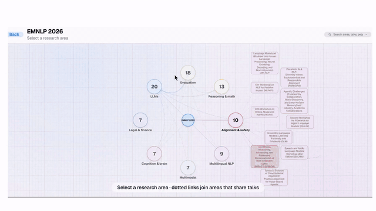
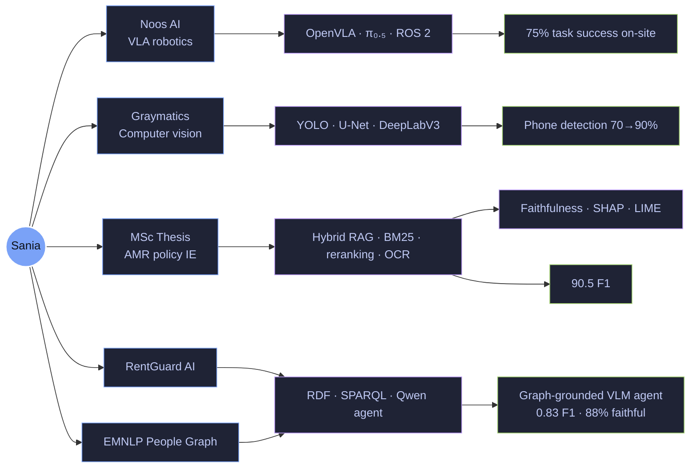
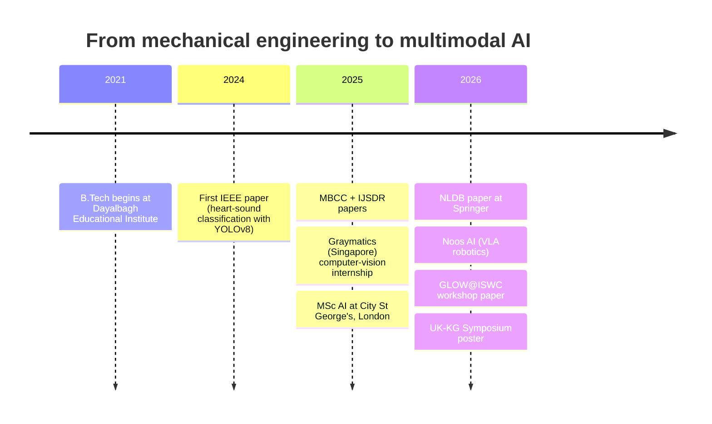

<!-- ============ HEADER ============ -->

  

 

---

## 🖥️ `whoami`

  

---

## 🔴 Live right now

| | |
|:--|:--|
| 🤖 **Building** | Vision-Language-Action pipelines for wind-turbine hub-bolt inspection at [Noos AI](https://www.linkedin.com/in/sania-verma) |
| 🏠 **Shipping** | [RentGuard AI](https://github.com/sania8/rentguard-ai): a Chrome extension that checks rental listings against an RDF rules graph |
| 🕸️ **Presenting** | A poster at the [**UK Knowledge Graphs Symposium 2026**](https://uk-knowledge-graphs.github.io/events/symposium-2026/) (13 Nov, City St George's, London) |
| 📝 **Writing up** | MSc thesis on multilingual LLM/RAG information extraction for antimicrobial-resistance policy |
| ⚡ **Compute** | 5,000 GPU hours awarded on **LUMI-G** (EuroHPC) for frugal edge-AI robotic control |

> 💬 **Want to talk LLMs, RAG, knowledge graphs or embodied AI?** &nbsp; [**Click here to email me**](mailto:saniav2711@gmail.com?subject=Hi%20Sania%20%E2%80%94%20found%20you%20on%20GitHub&body=Hi%20Sania%2C%0A%0AI%20saw%20your%20profile%20and%20wanted%20to%20talk%20about%20...) (subject line pre-filled)

---

## ✨ Featured: EMNLP 2026 People Graph

### [🔗 Explore the live graph](https://emnlp-graph.saniav2711.workers.dev) &nbsp;·&nbsp; [📂 View the code](https://github.com/sania8/YOUR-REPO-NAME)

An interactive map of **sessions → talks → researchers → institutions** at EMNLP 2026. A Python pipeline (HTML parsing + RDFLib) turns the official programme into a reusable RDF knowledge graph (JSON + Turtle), and a **Next.js / React / TypeScript** front end lets you wander through it. Deployed on Cloudflare with automatic builds on every push.

---

## 🧬 My work, as a knowledge graph

*This README is a graph too. Everything I build connects to a few core ideas:*

---

## 🗺️ Journey

---

## 🧭 Explore (click to expand)

<b>💼 &nbsp;Experience</b>

 

**AI Engineer Intern · [Noos AI](https://www.linkedin.com/in/sania-verma)**, London · *Jul 2026 – present*
- Client-facing proof of concept for automated wind-turbine hub-bolt inspection using open-weight VLA models (OpenVLA, π₀.₅) and Hugging Face Transformers.
- Python, C++, ROS 2 and Linux integrating AI models, LiDAR and vision with a robotic arm, plus a web dashboard and REST API.
- **75% task success in physical trials** vs a 60% simulation baseline (CAD-based Gazebo).

**AI Algorithm Engineer Intern · Graymatics**, Singapore (remote) · *Jul – Dec 2025*
- Dockerised CV services on AWS across **30 live cameras** (Python, TensorFlow, YOLO, MediaPipe).
- Phone detection **70% → 90%**; smoke detection for Olam, Turkey at **97.6%** with 30% fewer false positives; geospatial segmentation (DeepLabV3 / U-Net, Dice 0.80–0.90).

**ML & Data Platform Engineer (Freelance) · Hankernest Technologies**, India · *Feb – Jun 2025*
- Azure Databricks + PySpark pipelines for attendance forecasting (**86%**), Power BI dashboards.
- Ran AI/ML workshops for **200+ students and teachers**, with edge demos on Arduino and Raspberry Pi.

<b>🔬 &nbsp;Research projects</b>

 

| Project | Highlights | Collaborators |
|:--|:--|:--|
| **LLM-based multilingual IE for AMR policy documents** *(MSc thesis)* | Hybrid dense + BM25 retrieval with reranking, Tesseract OCR; **90.5 F1** | Imperial College London (Fleming Initiative), NHS |
| **Power-line fault detection & risk reasoning** | Fine-tuned VLM + Neo4j KG; **0.83 F1**, **88% faithfulness** | EPAM Systems, MathWorks |
| **Robustness of fine-tuned LLMs** | Mistral, Gemma, Qwen with LoRA/QLoRA under perturbation; Mistral most stable (87% of trials at 90%+ confidence) | EPAM Systems, University of Hull |

<b>🚀 &nbsp;Projects</b>

 

**[RentGuard AI](https://github.com/sania8/rentguard-ai)** · Chrome MV3 extension + FastAPI backend that pulls rent, deposit, tenancy length and bills from listings; rules and official sources modelled as an RDF graph (RDFLib, SPARQL, PyVis); a Qwen agent explaining findings in plain language is in progress.

**[EMNLP 2026 People Graph](https://emnlp-graph.saniav2711.workers.dev)** · Next.js, React, TypeScript, RDFLib, Cloudflare.

**[MathSolver Pro / SolWise](https://github.com/sania-verma/mathsolver-pro)** · AI maths-learning platform with 12+ features (Flask, Groq LLaMA 3.1, SymPy, Plotly) · [Live demo](https://mathsolver-pro.onrender.com)

**Web Summarizer Chrome plugin** · **LocalChat AI** (private on-device RAG with Ollama + LangChain) · **EEG motor-imagery CNNs** · **Single-cell RNA-seq analysis** ([blog post](https://medium.com/@saniav2711/single-cell-rna-seq-data-analysis-identifying-cell-types-in-pbmc-samples-fe15fed2f078)) · **Virtual Lab: quantum physics simulations** (Ministry of Education funded, [view](https://github.com/virtual-labs/engineers-forum/issues/855))

<b>🛠️ &nbsp;Tech stack</b>

 

**LLMs & RAG:** prompt engineering, structured JSON outputs, embeddings, vector search, hybrid retrieval (dense + BM25), reranking, agentic AI, LoRA/QLoRA, Qwen / Mistral / Gemma
**Document AI:** Tesseract OCR, multilingual image-heavy documents
**Graphs:** RDFLib, SPARQL, Neo4j, PyVis
**Vision & robotics:** YOLO, MediaPipe, DeepLabV3, U-Net, VLMs, VLA, Gazebo, LiDAR, Arduino, Raspberry Pi
**Evaluation:** error analysis, faithfulness, SHAP, LIME, GSMILE

<b>🏆 &nbsp;Achievements</b>

 

- ⚡ **5,000 GPU hours on LUMI-G** via a successful EuroHPC compute application (frugal edge-AI models for robotic control in wind-turbine inspection, with Noos AI's co-founders)
- 🎓 Hands-on GenAI workshop by Neo4j GraphAcademy, AI Graph Summit London (6 Oct 2026)
- 🎤 Presented at **NLDB 2026**; ran workshops for 200+ attendees
- 🌾 **Best Researcher Award**, "True IoT in Digital Agriculture" track, G2O Symposium (Graphic Era, Uttarakhand)

<b>🎓 &nbsp;Education</b>

 

- **M.Sc. Artificial Intelligence**, City St George's, University of London (2025 – 2026)
- **B.Tech. Mechanical Engineering (CS specialisation)**, Dayalbagh Educational Institute, Agra (2021 – 2025)

<b>🥚 &nbsp;Click for a secret</b>

 

I started in **mechanical engineering**, so I like AI that touches the physical world: robots, cameras, sensors. Ask me about the time a model scored 70% in the lab and 90% on a real factory floor. 🏭

---

## 📚 Publications

*Chronological · full list on [Google Scholar](https://scholar.google.com/citations?user=OWKs_vsAAAAJ&hl=en)*

| # | Date | Paper | Venue | Status |
|:-:|:--|:--|:--|:--|
| 1 | Nov 2024 | **[Spectrogram-Driven Heart Sound Classification using YOLOv8 for Mobile Health Monitoring](https://ieeexplore.ieee.org/abstract/document/10868008/)** *S. Verma, H. Chadda* | IEEE ICSIDP 2024, pp. 1–6 | ✅ Published |
| 2 | Apr 2025 | **Advancing Autonomous Industries: A Comprehensive Review of Computer Vision Technologies and Emerging Trends** *A. Gupta, S. Verma* | Int. Journal of Scientific Development and Research, 10(4), b218–b229 | ✅ Published |
| 3 | Jun 2025 | **[The Unfinished Race: Bridging the Gap Between AI Vision Models and Human Motion Perception](https://link.springer.com/chapter/10.1007/978-3-032-19966-9_9)** *S. Verma, H. Chadda* | Mind, Brain, and Consciousness Conference, Springer, pp. 94–104 | ✅ Published |
| 4 | Jun 2026 | **[When Words Move Markets: Interpretable Behavioural and Robustness Analysis of LLMs for Financial Sentiment Reasoning via Local Perturbation Explanations](https://link.springer.com/chapter/10.1007/978-3-032-29532-3_19)** *S. Verma, K. Aslansefat, J. Chatterjee, A. Marar, A. Mehra, A. Ekundayo* | NLDB 2026, Springer LNCS, pp. 271–286 | ✅ Published · 🎤 Presented |
| 5 | 2026 | **Graph-Grounded Multimodal Agent for Trustworthy Power-Line Operations and Maintenance** *S. Verma, J. Chatterjee, et al.* | **GLOW @ ISWC 2026** workshop | 🟢 Accepted |
| 6 | 13 Nov 2026 | **[Knowledge Graph-Guided Visual Memory for Efficient Vision-Language Question Answering](https://uk-knowledge-graphs.github.io/events/symposium-2026/)** *S. Verma* | Poster · 5th UK Knowledge Graphs Symposium, City St George's, London | 🟢 Accepted |

<b>📈 &nbsp;What the papers say (abstract snippets)</b>

 

- **#1:** Converts phonocardiogram recordings to spectrograms and classifies them with YOLOv8. Trained on PhysioNet/CinC 2016: **94.5% accuracy, 0.95 F1, 0.97 recall**, handling class imbalance better than LSTM or ResNet-18 at lower compute.
- **#3:** Uses kinematograms (motion decoupled from shape) to show that Farneback and Horn-Schunck optical flow fail, and RAFT only partly works, on stimuli humans handle easily.
- **#4:** Applies GSMILE to fine-tuned Gemma-3-270M, Mistral-7B-Instruct and Qwen-2.5-0.5B-Instruct to explain how financial-sentiment predictions depend on token-level evidence and context.

---

## 📊 GitHub activity

 

 

 

<!-- Needs .github/workflows/snake.yml (included); the snake appears after the first run -->
<picture>
  <source media="(prefers-color-scheme: dark)" srcset="https://raw.githubusercontent.com/sania8/sania8/output/github-snake-dark.svg"/>
  
</picture>

---

## 🤝 Let's connect

Open to collaborating on **LLMs, RAG, knowledge graphs and embodied AI**.

 

*"Deep learning is not just about algorithms; it's about understanding intelligence itself."*

